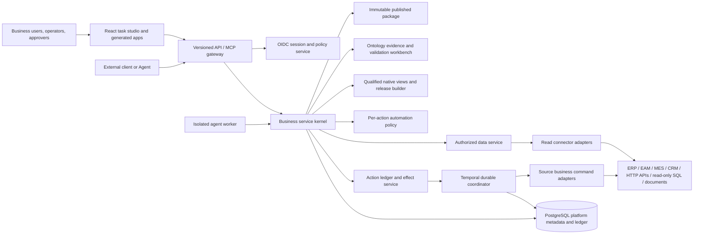

# System Architecture

**Version:** 0.1.0 · **Status:** Design baseline · **Updated:** 2026-11-03

## Context and boundaries

The qualified ObjectStack runtime plus narrowly scoped governance plugins form the business service kernel between every surface and every source. There is no direct browser-to-source path and no Agent-to-source credential path. API, agent and Temporal workers may be separate processes, but they call the same versioned published capability services.

The core product loop is: source profile → discovered capabilities → evidence-backed proposals in ObjectStack-native metadata → native/extension validation and read-only dry run → per-action policy → app-release manifest → immutable release → current-policy runtime. The ontology workbench drafts task-sized changes against ObjectStack's qualified metadata; it does not create a competing object/action/permission/view engine. The release builder packages only qualified declarative UI assets, native bundle references and narrow app composition. The runtime resolves current identity, permissions, connector grants, secrets, source freshness and policy on each request.

Process boundaries are security boundaries. Each worker uses a distinct workload identity, TLS-authenticated internal API, least-privilege scopes and network policy. Do not share a platform-admin token between API, agent and action processes. Model egress is allowlisted; the action worker has source egress only to configured endpoints; the API does not need broad source write credentials.

## Deployment shape

Start with a modular monolith composed of independently runnable processes:

- `api`: HTTPS API, web session/BFF endpoints, public API, admin endpoints, SSE status stream, and MCP HTTP endpoint.
- `web`: static React application served by a reverse proxy or API static handler.
- `agent-worker`: isolated model/runtime calls and planning; no broad source credentials; network egress restricted to configured model providers and platform API.
- `action-worker`: Temporal worker that executes only already-authorized action intents and reconciles known source operations.
- `temporal`: durable execution service.
- `postgres`: platform store, action ledger, audit, and outbox.
- `connector-gateway` (later optional profile): customer-managed outbound connector for private sources. It is a constrained connector host, not a privileged tunnel or a second policy authority; do not add it until TP-23 security gates pass.

The local developer path uses Docker Compose with a synthetic fixture and development identity. A production installation requires customer OIDC, persistent keys, TLS/reverse proxy, database backup, secret provider, and a configured model endpoint. Do not expose development identity or default secrets in a production profile. Kubernetes packaging waits for operational demand, supported upgrade strategy, and security review.

## Technology baseline

| Concern | Selection | Rationale and limit |
|---|---|---|
| Language/runtime | TypeScript, Node.js 24 LTS baseline; pin exact patch in `.nvmrc`/toolchain config and CI | Shared types and broad ecosystem; support Node 26 after ObjectStack and Temporal qualification |
| Monorepo | pnpm workspaces + Turborepo | Reproducible package graph and scoped tasks; lockfile committed; no global install assumption |
| Business runtime | **ObjectStack OSS is the preferred foundation to qualify**: `@objectstack/spec`, core/runtime, ObjectQL, SQL driver, security/audit/approval and MCP plugins where each passes the gate | Strong semantic fit for metadata-driven objects/actions/permissions/UI. Small and fast-moving ecosystem means pin exact versions and prove deployment, OIDC, connector and permission behavior before relying on it |
| HTTP/API | ObjectStack REST/Hono server plugin and generated routes for governed read APIs; add a thin route/plugin only for a documented gap | Do not create a parallel server or metadata engine. Disable generic write routes for source business records unless they delegate to a named action boundary |
| Web | React + Vite + TypeScript; ObjectStack client/ObjectUI components where qualified; TanStack Query for server state | Guided authoring and controlled task-app renderer; server remains authority |
| UI primitives | ObjectUI or accessible React primitives with a small project design system; Tailwind tokens only if the chosen ObjectStack UI version requires them | Generated apps use a reviewed registry, not arbitrary component code |
| Database | PostgreSQL as platform store through the qualified ObjectStack SQL driver and migration mechanism | Open and self-hostable; RLS is defense in depth, not sole authorization. No separate Drizzle domain model |
| Validation/contracts | Reuse ObjectStack Zod/spec types for object/action/UI metadata; add a narrow platform extension schema for task evidence, readiness, effect/reconciliation contract; export JSON Schema/OpenAPI | Do not redefine ObjectStack objects/actions. Published platform extension stays language-neutral and versioned |
| Durable work | Temporal TypeScript SDK for long-running actions and reconciliation | Durable retry/state primitives; one coordinator only. Hide behind `DurableCoordinator` interface |
| Agent stream UI | AG-UI protocol at interaction boundary where it fits; version our public domain events independently | Interop for streaming/state; never treat protocol events as authorization or source effects |
| Agent harness | Start with an internal `AgentRuntime` interface and one-agent provider loop; qualify ObjectStack AI/MCP plugin and one optional harness integration against the kernel | Keep framework state out of business package and action ledger; avoid multi-agent until a measured use case |
| Model providers | OpenAI-compatible provider adapter plus one explicitly supported local/provider adapter; no silent provider fallback | Provider choice, data residency, retention, and tool calling differ; customer config is explicit |
| Identity | OIDC Authorization Code + PKCE; server-side session for browser; standard bearer auth for service clients | Use existing enterprise identity; dev-only mock identity is isolated from production |
| MCP | Official MCP SDK behind platform gateway; expose only published query/action capability IDs; consume external servers through explicit allowlist | Protocol is interoperability, not permission grant or trust signal |
| Telemetry | OpenTelemetry API/SDK for traces and metrics, structured JSON logs | Correlate without recording secrets or full business payloads |

### Why a modular monolith

The core difficulty is consistent rules across generated surfaces, not independent scaling of microservices. Keep contracts, auth, package validation, data, and action semantics in one domain codebase until scale or ownership boundaries are measured. Process separation is justified for model calls and side-effect workers due to egress and credential risk.

### Framework qualification gate

Before building product features on the runtime, complete TP-02: create a minimal ObjectStack host with the selected framework packages; test PostgreSQL SQL driver/migration/backup; prove external OIDC authentication and deny-by-default object/field/record permissions; prove generic REST/MCP CRUD cannot bypass named action controls; test one read connector and one approved business action prototype; test React controlled UI metadata; test Temporal execution/timeout/replay separately. Record exact versions, package-specific licenses, compatibility, security controls, support status, install/upgrade cost and gaps in ADR-0002. Adopt ObjectStack only if the core permission and extensibility boundaries pass. If it fails, record why and choose a single replacement architecture; do not build parallel cores.

## Runtime request flows

### Read flow

1. API verifies OIDC session/token, installation context, CSRF if cookie-authenticated, request schema, rate limit, and request correlation.
2. AuthZ resolves actor, current roles/attributes, app release, capability grants, and source identity mode.
3. Query service resolves the capability from an immutable release and validates/filter-bounds arguments.
4. Source planner executes only declared connector operations with per-source timeout, page/byte/row/parallelism budget.
5. Results are filtered and sensitivity-redacted before any model context; each value retains provenance and freshness metadata.
6. API returns the typed result and records an audit reference. Partial, stale, truncated, and unavailable states are explicit.

### Agent flow

1. API creates a run with the authenticated actor and released app/package versions.
2. Agent worker receives only approved read capabilities and safe context resolved by the kernel.
3. The model proposes a typed capability call. Runtime validates it and asks the kernel to execute; model output never contains trusted actor or approval fields.
4. If an action is requested, runtime asks the kernel for a preview and effect summary. The user interface obtains confirmation or routes business approval; the model cannot supply either decision.
5. The API reauthorizes and starts a durable action only after all required decisions bind to the exact effect digest.
6. Temporal activity calls the source business API using a narrow credential and operation key. Reconciliation determines source truth after ambiguous failures.

### UI generation flow

The Agent may propose a draft app manifest using stable ObjectStack view/capability/component IDs. It cannot define a second object, field, action, permission or view schema. Qualified native validators check native view metadata; platform validators check only app-composition references, policy, sensitivity and cross-boundary invariants. A publisher releases an immutable combined digest. At request time the server computes current roles and capability availability; a saved spec never freezes a user's old permissions.

The deployable artifact is an OCI image or static bundle that contains the renderer, qualified native view metadata, narrow app manifest, component-catalog version and release manifest. It contains no source/model credentials, no user authorization snapshot, and no source data. It calls the platform API/runtime or a customer-managed runtime endpoint. Promotion across dev/test/prod reuses the same artifact digest while each environment resolves its own approved secret references and grants. Per-application custom code and automatic plugin installation are outside v1.

## Availability and failure semantics

- Database unavailable: return a dependency error; no business write is submitted.
- Temporal unavailable: read-only/query capabilities may continue if configured; new write intents remain blocked/pending, never run in memory.
- Model provider unavailable: allow non-agent forms and human task handling; do not switch to an unconfigured provider.
- One source unavailable: expose partial/blocked result according to capability contract; do not fabricate empty data.
- Source write timeout: record `outcome_unknown`; reconcile via source query/idempotency key before a retry.
- Connector/schema drift: pause dependent capability and require mapping revalidation; unaffected capabilities can remain available.

## Security boundaries

Trust boundaries are the browser, LLM/provider, retrieved content, external MCP server, connector code, platform API, action worker, source system, and identity/secret systems. Detailed threats and controls are in [THREAT-MODEL.md](THREAT-MODEL.md). Treat LLM and all external content as untrusted. The API/kernel own identity, authorization, package validation, canonical effect, and audit.

